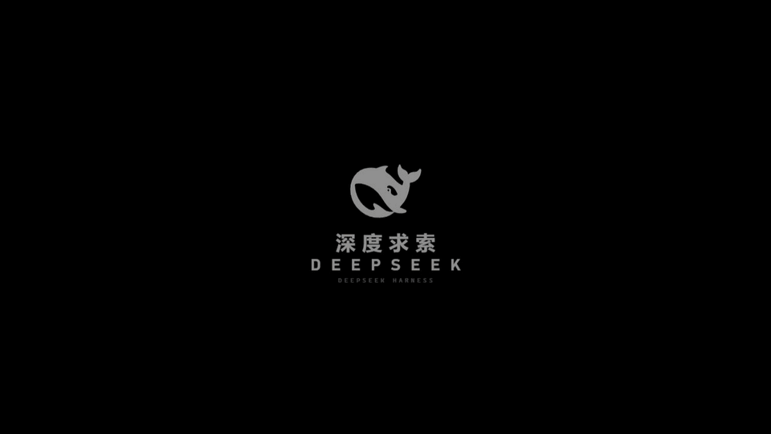

# dsh-boot-suite

> **A boot suite for DeepSeek Harness** — a six-act cold-start animation plus a chat wallpaper.
> One plugin, two independent halves: the ritual of startup, and the backdrop you live on afterwards.

> The GIF is recorded frame-by-frame from `preview/demo.html`. The real thing has real voice lines and UI sound effects.

---

## What it is

On cold start, DSH plays a six-act sequence, then hands over to the chat with your own wallpaper behind it:

    black screen / DeepSeek mark → overexposed wash → warm "technical dossier" plate
      → five-step interactive authorization → glitch reveal → chat wallpaper

**This is not a video file — it is a code animation.** `lib/splash.js` (1468 lines) + `lib/splash.css` (1093 lines)
draw everything with DOM, CSS animation and WebAudio. The visual part ships as ~94 KB of text.

| | Boot animation | Chat wallpaper |
|---|---|---|
| Entry | Settings → "启动动画" | Settings → "聊天背景" |
| Content | six acts, typewriter subtitles, targeting ring, chromatic glitch | intro video / static image / big text banner |
| Media | 5 real-voice lines + welcome line + 2 UI sfx (mp3) | your own video and images |
| Tunable | 33 options: identity, id, access level, colors, speed, voice, copy | placement, loop range, veil opacity, banner text |

Each half is **independent**: a broken animation never breaks the wallpaper and vice versa; the UI always comes up.

## Install

    # Quit DeepSeek Harness Desktop completely first
    dsh plugin --profile desktop add link:<path-to-this-repo>

Requires Node ≥ 20. The desktop app must be fully quit — the profile's `package.json` is locked while it runs.

## Safety kit

This plugin injects into the **first paint**, so a bug can mean a full black screen where even "skip" is unreachable.
The repo ships three maintenance scripts that work **without a usable UI**:

| Tool | Purpose |
|---|---|
| `tools/emergency-uninstall.cmd` | remove the plugin entirely, restore the plain client |
| `tools/rollback.cmd` | roll back to the newest snapshot under `backups/` |
| `tools/make-backup.ps1` | snapshot the current state (run before editing code) |

Kill every `DeepSeek Harness` process, run the script, relaunch. Diagnostics land in `~/.dsh/boot-suite-diag.log`.

## Tests

    npm test

13 self-contained smoke suites, ~450 assertions, no runtime dependencies.

## License

MIT for the original code and copy. Visual style references an anime; audio assets come from a third-party video
and remain with their rights holders. **No commercial use is granted.**

Original author: 沈宏宏 · Merged, fixed and maintained by LeeRolling
